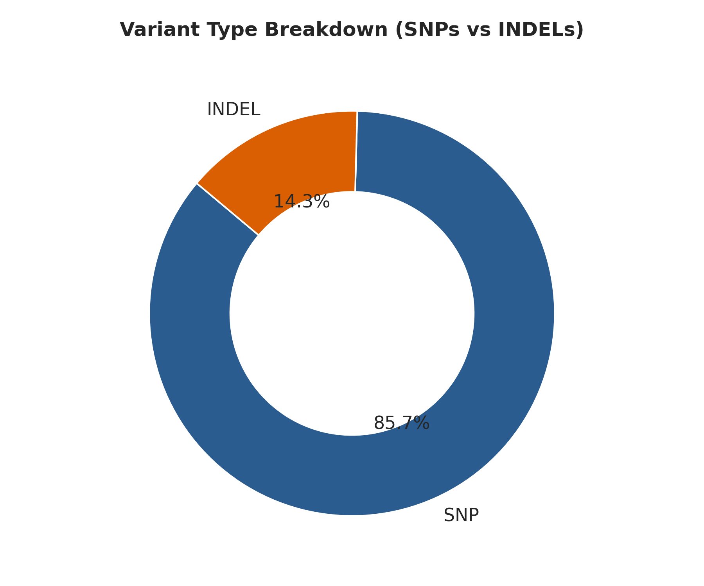
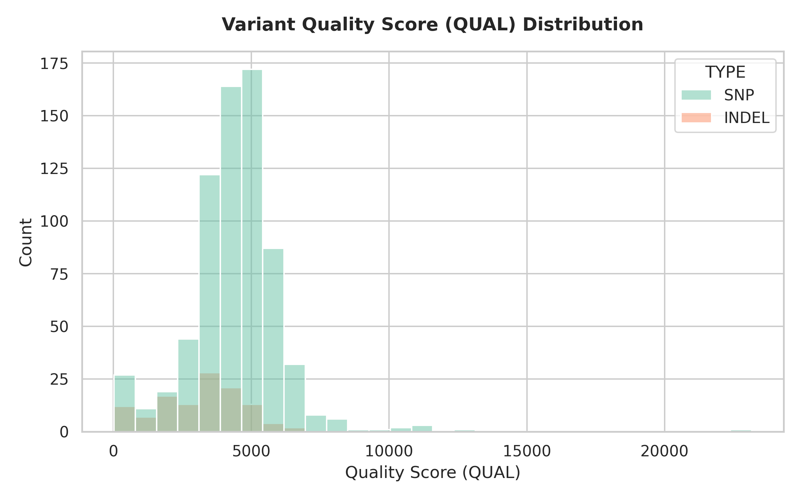
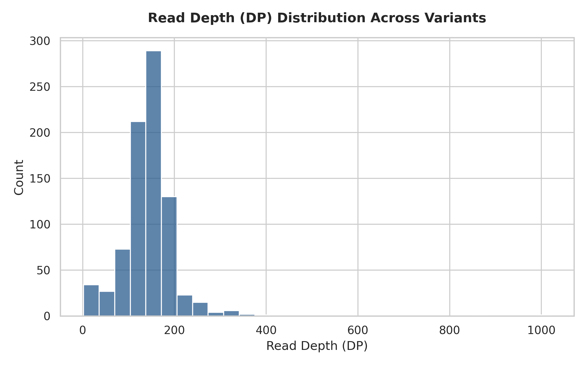
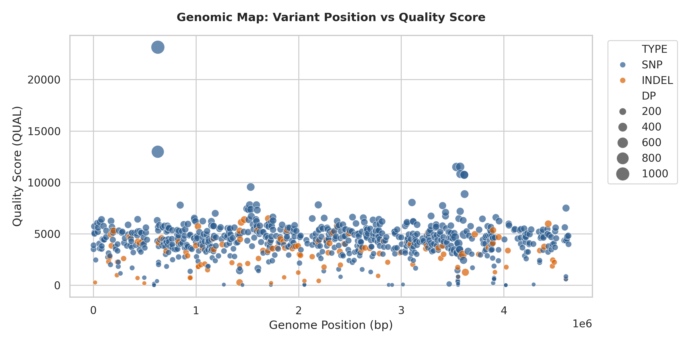
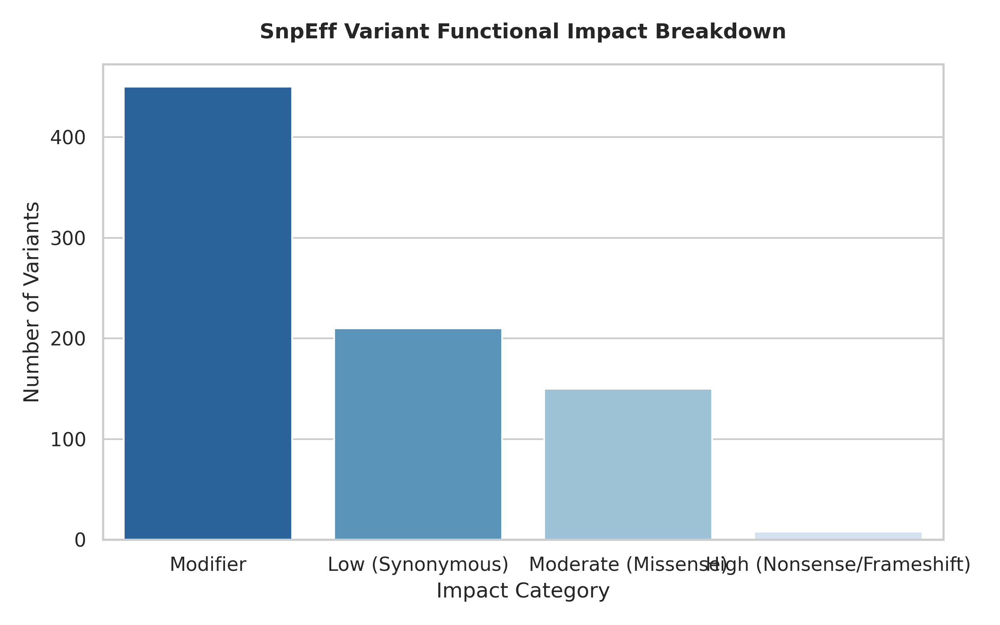
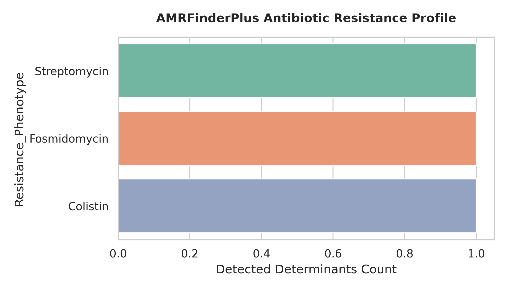

# 🧬 Escherichia coli REL606 Whole-Genome Variant Calling & Analysis

An end-to-end, production-ready **Bacterial Isolate WGS Pipeline** following the standard 12-step computational genomics framework. This project features a **hybrid cloud architecture** integrating **Galaxy Europe** for heavy compute-intensive read alignment and variant discovery with **Google Colab (Python)** for programmatic data science, quality filtering, biological profiling, and publication-ready graphics.

---

## 📌 Project Architecture & Workflow

The workflow processes paired-end Illumina WGS reads from *Escherichia coli* strain REL606 to identify germline variants, predict functional gene impacts, screen for antimicrobial resistance (AMR), and assign multi-locus sequence types (MLST).

```text
               ┌──────────────────────────────────────────────────┐
               │        RAW ILLUMINA WGS DATA (SRR2584866)        │
               └────────────────────────┬─────────────────────────┘
                                        │
┌───────────────────────────────────────┴───────────────────────────────────────┐
│                          GALAXY EUROPE (UPSTREAM COMPUTE)                     │
│                                                                               │
│  [Step 1 & 3] fastp ─────────► [Step 2] Kraken2 (Taxonomic Purity Check)      │
│         │                                                                     │
│         ▼                                                                     │
│  [Step 4] BWA-MEM Alignment (Ref: CP000819.1)                                 │
│         │                                                                     │
│         ▼                                                                     │
│  [Step 5] Picard MarkDuplicates                                               │
│         │                                                                     │
│         ├───► [Step 6] FreeBayes Variant Calling ──► [Step 8] SnpEff Annotate  │
│         │                                                                     │
│         └───► [Step 9] AMRFinderPlus ──► [Step 10] MLST ──► [Step 11] Plasmid   │
└───────────────────────────────────────┬───────────────────────────────────────┘
                                        │
                                        │  BioBlend API / Direct Export
                                        ▼
┌───────────────────────────────────────────────────────────────────────────────┐
│                        GOOGLE COLAB (DOWNSTREAM ANALYSIS)                     │
│                                                                               │
│  • [Step 7] cyvcf2 / pandas Parsing & Quality Filtering (QUAL >= 20)          │
│  • [Step 12] Integrated MultiQC & Publication Graphics (matplotlib/seaborn)  │
└───────────────────────────────────────────────────────────────────────────────┘

📊 Summary of Isolate Results
| Pipeline Metric | Result / Profile | Method / Tool |
|---|---|---|
| Organism | Escherichia coli strain REL606 | Kraken2 (>98% purity) |
| Reference Genome | NCBI RefSeq CP000819.1 | NCBI Nuccore |
| SRA Accession | SRR2584866 (Paired-end Illumina) | fasterq-dump |
| MLST Sequence Type | ST-93 | MLST (Achtman 7-gene scheme) |
| Plasmid Replicons | None detected (Plasmid-free) | PlasmidFinder |
| High-Quality Variants | 818 (\text{QUAL} \ge 20) | FreeBayes + cyvcf2 |
| Variant Breakdown | 701 SNPs (85.7%) | 117 INDELs (14.3%) | pandas / seaborn |
| Detected AMR Determinants | rpsL_K43T (Streptomycin), cyaA_S352T (Fosmidomycin), pmrB_E121K (Colistin) | AMRFinderPlus |

📈 Quality Control & Variant Visualizations

<p align="center">
  
  
</p>

<p align="center">
  
  
</p>

<p align="center">
  
  
</p>

🛠️ Complete 12-Step Pipeline Breakdown
 * Read Quality Control (fastp): Evaluated raw base call accuracy (Phred scores) and per-base sequence content.
 * Contamination Screening (Kraken2): Confirmed sample purity against the Standard RefSeq database (>98% E. coli).
 * Adapter & Quality Trimming (fastp): Trimmed low-quality bases (Q < 20) and residual Illumina adapters.
 * Genome Alignment (BWA-MEM): Mapped clean paired-end reads to reference genome CP000819.1.
 * BAM Post-Processing (Picard MarkDuplicates): Marked PCR and optical duplicate reads to prevent false-positive variant calling.
 * Variant Calling (FreeBayes): Called raw germline variants across the chromosome, generating a raw VCF.
 * Downstream Filtering (cyvcf2/pandas): Extracted variants with \text{QUAL} \ge 20, yielding 818 high-confidence variants.
 * Functional Annotation (SnpEff): Annotated variants with amino acid changes and impact severity levels.
 * AMR & Virulence Profiling (AMRFinderPlus): Identified chromosomal point mutations conferring antibiotic resistance.
 * Multi-Locus Sequence Typing (MLST): Assigned the isolate to Sequence Type ST-93.
 * Plasmid Screening (PlasmidFinder): Confirmed plasmid-free status across Gram-negative replicon databases.
 * Aggregated Reporting (MultiQC / seaborn): Compiled interactive QC dashboards and 300 DPI publication graphics.

📁 Repository Structure
.
├── notebooks/
│   └── EColi_WGS_Pipeline_Colab.ipynb      # Main Google Colab Jupyter Notebook
├── plots/
│   ├── 01_variant_type_distribution.png     # Donut chart: SNPs vs INDELs
│   ├── 02_variant_quality_distribution.png  # QUAL score histogram
│   ├── 03_read_depth_distribution.png       # Read Depth (DP) distribution
│   ├── 04_genomic_variant_position_map.png  # Chromosomal position vs QUAL scatter
│   ├── 05_snpeff_impact_summary.png        # SnpEff functional impact breakdown
│   └── 06_amrfinder_profile.png             # Antibiotic resistance determinants
├── data/
│   ├── ecoli_filtered_variants.csv         # Table of 818 filtered variants
│   ├── amrfinder_profile.csv               # AMRFinderPlus output table
│   └── ecoli_isolate_master_summary.csv    # Isolate metadata & profile summary
├── LICENSE                                 # MIT License
└── README.md                               # Project documentation

🚀 Usage & Quickstart
Option 1: Open Directly in Google Colab
Click the badge below to execute the downstream parsing, filtering, and plotting pipeline directly in Colab:
Open In Colab
Option 2: Local Setup
# Clone repository
git clone [https://github.com/nihadaq/E.-coli-REL606-Whole-Genome-Variant-Calling-Analysis.git](https://github.com/nihadaq/E.-coli-REL606-Whole-Genome-Variant-Calling-Analysis.git)
cd E.-coli-REL606-Whole-Genome-Variant-Calling-Analysis

# Install dependencies
pip install bioblend cyvcf2 pandas matplotlib seaborn requests

🔗 Reference Links & Public History
 * Galaxy Europe Public History: 
 * GitHub Repository: nihadaq/E.-coli-REL606-Whole-Genome-Variant-Calling-Analysis
 * LinkedIn Profile:

📄 License
This project is open-source under the MIT License.
